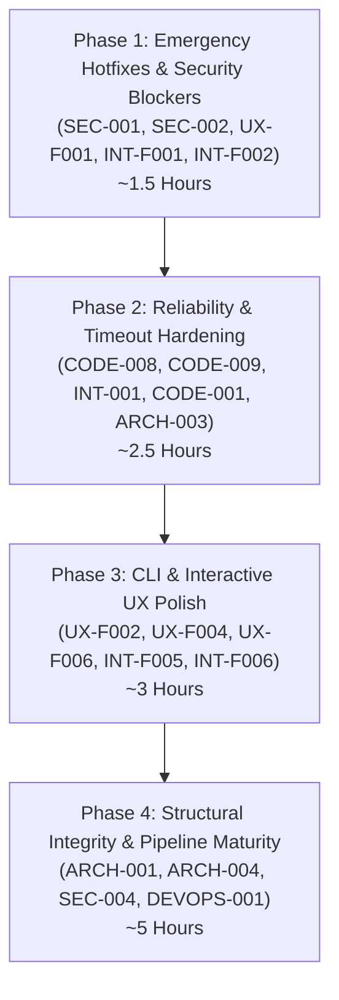

# ACTIONABLE REMEDIATION MASTER PLAN

**Project:** Azure DevOps SDLC Agent (`ado-sdlc-agent`)  
**Based on:** Technical Audit, CLI UX Audit, and Interactive Conversational QA Audits  
**Date:** 2026-10-10  
**Status:** Ready for Execution (Sprint Plan)  

---

## 1. Executive Strategy & Phasing

The audit exposed three distinct layers of issues:
1. **Critical Security & Safety Vulnerabilities:** Review-critical guardrail bypasses (`scope_guard.py`) and unconfirmed destructive actions (`clean`).
2. **Core Pipeline Reliability & Quality Gaps:** Stubbed nodes claiming false success, silent exception swallowing in `implement_node`, missing timeouts causing 13-minute hangs, and broken packaging.
3. **Developer Experience & Conversational Polish:** Unhandled 120-line tracebacks on missing credentials, lack of JSON machine output, abrupt `Ctrl+C` exits, and lack of persistent status feedback.

To address these without breaking existing functionality, work is structured into **4 sequential execution phases**:



---

## 2. Phase 1: Emergency Hotfixes & Security Blockers (Sprint Day 1, ~90 Mins)

> **Objective:** Close verified security bypasses and eliminate immediate data loss risks.

### Task 1.1: Fix Scope Guard Path Traversal & Substring Bypass
- **Tracking IDs:** `SEC-001`, `SEC-002`
- **Location:** `agent/guards/scope_guard.py:42`
- **Issue:** `clean_allowed in norm_file` allows arbitrary file modifications outside the plan (e.g., allowed `src/api` permits `src/api-evil/bad.cs`).
- **Action:**
  1. Remove substring `in` check.
  2. Implement strict path boundary matching:
     ```python
     boundary_match = norm_file == clean_allowed or norm_file.startswith(clean_allowed.rstrip("/") + "/")
     if fnmatch.fnmatch(norm_file, clean_allowed) or boundary_match:
         matched = True
         break
     ```
  3. Promote the two failing adversarial tests from `audit/scratch/test_adversarial.py` into `tests/test_scope_guard.py`.
- **Verification:** `uv run pytest tests/test_scope_guard.py` passes cleanly.

### Task 1.2: Fix `agent` CLI Entrypoint Packaging
- **Tracking ID:** `UX-F001`
- **Location:** `pyproject.toml`
- **Issue:** `uv run agent` fails with `os error 2: No such file or directory` because `ado-sdlc-agent` is not configured as an installable package.
- **Action:**
  Add `[build-system]` or `[tool.uv]` package declaration:
  ```toml
  [build-system]
  requires = ["hatchling"]
  build-backend = "hatchling.build"

  [tool.hatch.build.targets.wheel]
  packages = ["agent"]
  ```
- **Verification:** Run `uv sync && uv run agent --help` without error.

### Task 1.3: Add Confirmation Gate to Destructive `clean` Command
- **Tracking IDs:** `UX-F003`, `INT-F001`
- **Location:** `agent/ui/cli/main.py:126`, `agent/ui/cli/repl.py:53`, `agent/session/manager.py:83`
- **Issue:** `agent clean <id>` and `/clean <id>` permanently delete worktrees with no confirmation and report success even on nonexistent IDs.
- **Action:**
  1. Check if ticket exists in `ProjectManager.get_ticket_run(ticket_id)`. If missing, print error to STDERR and exit `1`.
  2. In CLI, add `typer.confirm("Are you sure you want to delete session and worktree for Ticket #<id>?", abort=True)` unless `--yes` / `-y` is passed.
  3. In REPL, prompt user `[y/N]` before calling `clean_ticket`.
- **Verification:** Test `clean` on missing ticket (exits 1) and valid ticket (prompts confirmation).

### Task 1.4: Fix Abrupt `Ctrl+C` Exit in Interactive REPL
- **Tracking ID:** `INT-F002`
- **Location:** `agent/ui/cli/repl.py:40-44`
- **Issue:** Pressing `Ctrl+C` to cancel a line immediately terminates the application.
- **Action:**
  Distinguish `KeyboardInterrupt` from `EOFError`:
  ```python
  except KeyboardInterrupt:
      console.print("\n[dim]Input cleared. (Type /exit or press Ctrl+D to quit)[/dim]")
      continue
  except EOFError:
      console.print("\n[dim]Exiting SDLC Agent. Goodbye![/dim]")
      break
  ```
- **Verification:** Run PTY test script sending `\x03`; verify REPL clears input and stays alive.

---

## 3. Phase 2: Reliability, Error Handling & Timeouts (~2.5 Hours)

> **Objective:** Prevent indefinite network hangs, stop silent coding agent failures, and route graph errors cleanly.

### Task 2.1: Add Hard HTTP Timeouts Across All Connectors & Clients
- **Tracking IDs:** `CODE-008`, `CODE-009`, `INT-001`
- **Location:**
  - `agent/llm/opencode_client.py:87`
  - `agent/connectors/ticket_source_azure.py:89, 103, 115, 128`
  - `agent/connectors/pr_host_azure.py:117`
- **Issue:** All `urllib.request.urlopen` calls lack `timeout=`, causing real 13-minute hangs (`RemoteDisconnected`) when endpoints stall. Violates `AGENTS.md` hard rule.
- **Action:**
  1. Thread `AgentConfig.external_timeout_seconds` (default 60s) into all connector classes.
  2. Update all `urlopen(req)` calls to `urlopen(req, timeout=self.timeout)`.
  3. Add `@pytest.mark.timeout(30)` or mock fallback to `test_integration_ado.py`.
- **Verification:** Run full test suite; no integration test can hang beyond 30s.

### Task 2.2: Stop Swallowing Exceptions in `implement_node`
- **Tracking ID:** `CODE-001`
- **Location:** `agent/nodes/implement.py:42-45`
- **Issue:** `except Exception: pass` swallows Pi agent crashes, missing binaries, or timeouts, creating an empty diff that passes verification as "successful."
- **Action:**
  1. Catch specific exceptions (`subprocess.TimeoutExpired`, `FileNotFoundError`).
  2. If the coding agent fails, record the error in `state.error` and state messages.
  3. If diff is empty and error occurred, do not claim success.
- **Verification:** Test `implement_node` with a failing fake agent; assert `state.error` is populated.

### Task 2.3: Implement Failure Terminal Node in SDLC State Graph
- **Tracking ID:** `ARCH-003`
- **Location:** `agent/graph.py`
- **Issue:** Graph has no error edges; exceptions crash the executor and leave sessions permanently orphaned in `status="running"`.
- **Action:**
  1. Add `failed` node:
     ```python
     def failed_node(state: RunState) -> dict[str, Any]:
         return {"status": "failed", "stage": "error"}
     ```
  2. Add conditional edge from `ingest`, `clarify_score`, `implement`, and `verify`: if `state.error` is set, route to `failed` $\rightarrow$ `END`.
- **Verification:** Simulate an invalid ticket fetch; verify session transitions to `failed`.

---

## 4. Phase 3: Developer & Interactive UX Polish (~3 Hours)

> **Objective:** Replace cryptic stack traces with human error boxes, enable JSON scripting, and add interactive discoverability.

### Task 3.1: Pre-Flight Credential Validation & Structured Error Formatting
- **Tracking IDs:** `UX-F002`, `INT-F006`
- **Location:** `agent/ui/cli/main.py:46`, `agent/session/manager.py:73`
- **Issue:** Missing ADO/OpenCode credentials trigger raw 120-line Python HTTP 401/404 tracebacks.
- **Action:**
  1. In `SessionManager.run_ticket()`, perform lightweight pre-flight check on `AZURE_DEVOPS_ORG`, `PROJECT`, and `PAT`.
  2. Wrap CLI execution in a structured error handler:
     ```
     ╭─ Azure DevOps Connection Error ──────────────────────────────────────────╮
     │ What: Could not fetch work item #42 from Azure DevOps.                   │
     │ Why:  Received HTTP 404 (Not Found). Organization or Ticket is missing.  │
     │ Next: Check your .env file or run `agent ado setup <org> <project>`.     │
     ╰──────────────────────────────────────────────────────────────────────────╯
     ```
  3. In `SessionManager.chat()`, format 401 errors into clear guidance: *"OPENCODE_API_KEY is missing or invalid. Check your .env file."*
- **Verification:** Run `agent run 42` in an empty sandbox; verify cleanly formatted box and exit code 1.

### Task 3.2: Implement Global `--json` Output Flag for Automation
- **Tracking ID:** `UX-F004`
- **Location:** `agent/ui/cli/main.py` (`status`, `list`, `attach`, `run`)
- **Issue:** All commands emit Rich tables or styled text; no machine-readable output exists for CI/CD scripting.
- **Action:**
  1. Add `--json` option to `status_cmd`, `attach_cmd`, and `run_cmd`.
  2. When `--json` is set, dump raw Pydantic JSON schemas (`[t.model_dump() for t in tickets]`) to STDOUT without Rich formatting or ANSI codes.
- **Verification:** Run `agent status --json | jq .`; ensure 100% valid JSON output.

### Task 3.3: Route All Error Messages to STDERR
- **Tracking ID:** `UX-F006`
- **Location:** `agent/ui/cli/main.py`
- **Issue:** Errors (e.g. "No session found") print to STDOUT, corrupting piped shell streams.
- **Action:**
  Initialize `err_console = Console(stderr=True)` and route all error dialogs and failure messages to `err_console`.
- **Verification:** Run `agent attach 9999 2>/dev/null`; verify STDOUT is empty.

### Task 3.4: Add Fuzzy Typo Matching for Slash Commands
- **Tracking ID:** `INT-F005`
- **Location:** `agent/session/manager.py:149`
- **Issue:** Typing `/hepl` or `/stat` results in a dead-end "Unknown command" string.
- **Action:**
  Use Python's `difflib.get_close_matches`:
  ```python
  matches = difflib.get_close_matches(cmd, ["/help", "/ado", "/run", "/status", "/clean", "/exit"])
  if matches:
      return f"Unknown command: `{cmd}`. Did you mean `{matches[0]}`? Type `/help` for available commands."
  ```
- **Verification:** Run PTY test with `/hepl`; verify suggestion is printed.

---

## 5. Phase 4: Structural Integrity & Pipeline Maturity (~5 Hours)

> **Objective:** Transition stubbed nodes to functional components, enable real branch pushes, and establish CI gating.

### Task 4.1: Implement Real Branch Push in `AzurePRHost`
- **Tracking ID:** `SEC-004`
- **Location:** `agent/connectors/pr_host_azure.py:55-70`
- **Issue:** `push_branch()` only logs a message in live mode; ADO PR creation will fail with "branch not found."
- **Action:**
  Execute git push via subprocess in the worktree:
  ```python
  subprocess.run(["git", "push", "origin", clean_branch], cwd=wt_path, check=True)
  ```
- **Verification:** Test dry-run remains a zero-write no-op; test branch push against a local bare git remote.

### Task 4.2: Harmonize Diff Line Caps and Config Precedence
- **Tracking ID:** `ARCH-004`
- **Location:** `agent/nodes/select_smallest.py:39`, `agent/guards/diff_cap.py`
- **Issue:** `select_smallest_node` hardcodes `max_diff_lines=150`, while `diff_cap.py` defaults to 300 and `AgentConfig.max_diff_lines` is ignored.
- **Action:**
  Source `max_diff_lines` from `AgentConfig` in `select_smallest_node`.
- **Verification:** Verify diff limit matches user configuration.

### Task 4.3: Implement CI/CD Pipeline Gating
- **Tracking ID:** `DEVOPS-001`
- **Location:** `.github/workflows/ci.yml`
- **Issue:** Zero automated gating exists in the repository.
- **Action:**
  Create GitHub Actions workflow running:
  - `uv sync`
  - `uv run ruff check . && uv run ruff format --check .`
  - `uv run pyright`
  - `uv run pytest -q -m "not integration"`
- **Verification:** Workflow passes cleanly in local runner (`act`) or on GitHub.

### Task 4.4: Progressive Implementation of Pipeline Stubs
- **Tracking ID:** `ARCH-001`
- **Location:** `impact_analysis.py`, `confirm_red.py`, `write_tests.py`, `verify.py`
- **Action:**
  Wire the injected `StackAdapter` and `Verifier` protocols into the nodes so tests and verification execute inside the worktree rather than returning static dummy reports.

---

## 6. Execution Matrix & File Impact

| Phase | Task ID | Area | Target Files | Effort | Breaking? |
|---|---|---|---|:---:|:---:|
| **1** | 1.1 | Security | `agent/guards/scope_guard.py`, `tests/test_scope_guard.py` | S (30m) | No |
| **1** | 1.2 | Packaging | `pyproject.toml` | S (15m) | No |
| **1** | 1.3 | Safety | `agent/ui/cli/main.py`, `agent/ui/cli/repl.py`, `agent/session/manager.py` | S (30m) | Minor (`--yes` needed in scripts) |
| **1** | 1.4 | UX | `agent/ui/cli/repl.py` | S (15m) | No |
| **2** | 2.1 | Reliability| `agent/llm/opencode_client.py`, `agent/connectors/*.py` | S (45m) | No |
| **2** | 2.2 | Reliability| `agent/nodes/implement.py` | S (30m) | No |
| **2** | 2.3 | Arch | `agent/graph.py`, `agent/core/state.py` | M (60m) | No |
| **3** | 3.1 | UX | `agent/ui/cli/main.py`, `agent/session/manager.py` | M (60m) | No |
| **3** | 3.2 | Scripting | `agent/ui/cli/main.py` | M (60m) | No |
| **3** | 3.3 | UX | `agent/ui/cli/main.py` | S (20m) | No |
| **3** | 3.4 | UX | `agent/session/manager.py` | S (20m) | No |
| **4** | 4.1 | Connectors | `agent/connectors/pr_host_azure.py` | M (60m) | No |
| **4** | 4.2 | Config | `agent/nodes/select_smallest.py` | S (15m) | No |
| **4** | 4.3 | DevOps | `.github/workflows/ci.yml` | S (30m) | No |
| **4** | 4.4 | Arch | `agent/nodes/impact_analysis.py`, `verify.py`, etc. | L (3h) | No |

---

## 7. Immediate Next Step

We are currently at the **Phase 1 gate**.  
Please approve beginning **Phase 1 (Tasks 1.1 through 1.4)**. Upon your confirmation, each task will be implemented, verified with passing tests, and reported with before/after evidence.

