# Architecture Notes

## Architecture As Documented (docs/ARCHITECTURE.md)

ARCHITECTURE.md describes a complete LangGraph state machine with:
- 14 named nodes in a linear pipeline with 3 human-interrupt points
- Real dependency injection via `TicketSource`, `PRHost`, `StackAdapter`, `Verifier`, `CodingAgent`, `LLMClient`, `HumanChannel`
- Podman sandbox for code execution
- LangSmith tracing
- Eval harness in `evals/`
- `auto_answer` eval channel
- `ado_comment` ADO reply channel

## Architecture As It Actually Is

```mermaid
flowchart TD
    START([START]) --> ingest
    ingest["ingest_node\n[PASS] REAL: fetches ticket, scrubs secrets"]
    ingest --> clarify_score
    clarify_score["clarify_score_node\n[PASS] REAL: LLM scoring + question gen\n[WARN] fallback: score=8.0 on parse fail"]
    clarify_score -->|score < 7.0| post_questions
    clarify_score -->|score >= 7.0| impact_analysis
    post_questions["post_questions_node\n[PASS] REAL: queues HumanRequest\n[INTERRUPT] INTERRUPT"]
    post_questions --> impact_analysis
    impact_analysis["impact_analysis_node\n[FAIL] STUB: static message, no CodeIndex"]
    impact_analysis --> propose_options
    propose_options["propose_options_node\n~ REAL: LLM call\n[WARN] bare except → fabricated fallback"]
    propose_options --> blast_score
    blast_score["blast_score_node\n[PASS] REAL: formula-based scoring"]
    blast_score --> select_smallest
    select_smallest["select_smallest_node\n[PASS] REAL: picks min score, builds Plan\n[WARN] max_diff_lines=150 hardcoded"]
    select_smallest --> approve_plan
    approve_plan["approve_plan_node\n[PASS] REAL: queues plan approval\n[INTERRUPT] INTERRUPT"]
    approve_plan --> write_tests
    write_tests["write_tests_node\n[FAIL] STUB: emits comment strings only"]
    write_tests --> confirm_red
    confirm_red["confirm_red_node\n[FAIL] STUB: always returns red_confirmed=True\n  without running any tests"]
    confirm_red --> implement
    implement["implement_node\n~ REAL: invokes PiCodingAgent\n[WARN] bare except → empty diff success\n[WARN] Pi binary likely not installed"]
    implement --> verify
    verify["verify_node\n[FAIL] STUB: hardcoded TestReport passed=1\n[PASS] REAL: scope_guard called\n[WARN] SEC-001: guard bypassable"]
    verify --> approve_pr
    approve_pr["approve_pr_node\n[PASS] REAL: queues PR approval\n[INTERRUPT] INTERRUPT"]
    approve_pr --> raise_draft_pr
    raise_draft_pr["raise_draft_pr_node\n[PASS] REAL: calls PRHost.create_draft_pr\n[WARN] push_branch is a no-op in live mode"]
    raise_draft_pr --> END([END])

    style impact_analysis fill:#ff9999
    style write_tests fill:#ff9999
    style confirm_red fill:#ff9999
    style verify fill:#ffcc99
    style implement fill:#ffcc99
```



**Legend:**
- [RED] Red: Complete stub — no real work performed
- [ORANGE] Orange: Partial — real external call made but with silent failure mode
- [PASS] Green (unlabelled): Functionally correct

---

## Documented vs. Reality Gap Table

| Component | Documented | Reality |
|---|---|---|
| Impact analysis | Uses `CodeIndex.callers()`, `usages()`, `covering_tests()` | Static message; no CodeIndex call |
| Test generation | Real unit tests + Playwright spec from acceptance criteria | Comment strings in a .cs file |
| Confirm red | Runs generated tests, asserts they fail | Always sets `red_confirmed=True` unconditionally |
| Verify | Build + lint + new tests + impacted tests + Playwright | Hardcoded `TestReport(passed=1)` + scope_guard only |
| Push branch | git push to remote | Log statement only (no-op) |
| Eval harness | `evals/report.py` markdown summary with per-ticket table | `evals/` directory does not exist |
| LangSmith tracing | Integrated | Zero LangSmith imports anywhere |
| Podman sandbox | Code runs in Podman (no network, resource limits) | No Podman; subprocess directly in worktree |
| auto_answer channel | Implemented for eval runs | Not implemented |
| ado_comment channel | Optional channel for ADO replies | Not implemented |
| CI pipeline | Implied by AGENTS.md "slice done when tests/ruff/pyright pass" | No CI config file |
| Dependency injection | Via protocol interfaces (correct) | Via closures (limits testability — ARCH-002) |

---

## Key Structural Weaknesses

### 1. Stub nodes in the "complete" graph (ARCH-001)
`impact_analysis`, `write_tests`, `confirm_red`, and `verify` are structurally wired but functionally empty. The pipeline reports success for a run that never ran tests, never analysed code, and never verified results. This is the most significant gap between documented and actual capability.

### 2. No failure routing (ARCH-003)
The graph has no error terminal. Any unhandled exception kills the graph executor and orphans the session at `status="running"`. There is no self-healing or user-facing error signal in the graph itself.

### 3. Scope guard bypass (SEC-001 / SEC-002)
The guard file that "must not be bypassed, loosened or silenced" (AGENTS.md) contains a verified bypass. The substring matching fallback undermines the entire file-allowlist enforcement.

### 4. Dependency closure anti-pattern (ARCH-002)
All node dependencies are frozen into lambda closures at graph-build time. LangGraph's `RunnableConfig.configurable` pattern would allow per-invocation dep injection (e.g. swapping `FakeLLMClient` for eval runs without rebuilding the graph).

### 5. Actual module dependency direction (correct)
```
UI layer (cli, tui)
    └── session/ (SessionManager, ProjectManager)
            └── core/ (schemas, state, protocols, config)
            └── connectors/ (ado, pr_host)
    NO direct imports: nodes, adapters, connectors from UI [PASS]

graph.py
    └── nodes/* ──────────── core/
    └── guards/* ─────────── core/
    └── connectors/* ─────── core/
    └── coding/* ─────────── core/
    └── llm/* ────────────── core/
```
The layering is correct. The directionality is enforced. No circular dependencies detected.

